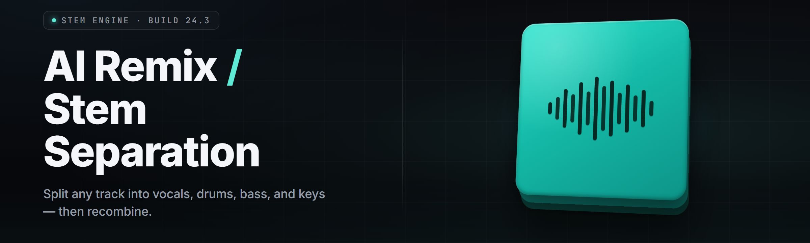

  
  
  

  

  
  

---

**Drop a track in. Walk out with stems, MIDI, and a remix that doesn't sound like a bot did it.**

A Windows `.exe` that runs a full AI stem-separation + remix pipeline on your own machine. No DAW plugins to juggle, no cloud upload, no subscription gate. Extract vocals, drums, bass, piano, guitar, and "everything else" from any song, then re-arrange, re-key, re-tempo, and re-instrument it into a remix — all local.

---

## 🎚️ Compatibility & Platform Support

| Platform | Status | Notes |
|---|---|---|
| Windows 10 (21H2+) | ✅ Full | DirectML + CUDA fallback |
| Windows 11 (23H2+) | ✅ Full | Recommended — best driver path |
| NVIDIA (CUDA 12.x) | ✅ Full | Fastest separation, ~8x realtime on 3060 |
| AMD (DirectML) | ✅ Full | Works, ~3x realtime on RX 6700 |
| Intel Arc (DirectML) | ⚠️ Partial | Slower, some models fall back to CPU |
| CPU-only (AVX2) | ⚠️ Partial | Runs, real-time factor ~0.6x, usable but slow |
| Linux / macOS | ❌ None | This build is Windows `.exe` only |

`.exe` ships self-contained. Extract, run, done.

---

## 📥 Download

  

---

## 🧭 Table of Contents

- [Overview](#-overview)
- [What is Stem Separation + AI Remix?](#-what-is-stem-separation--ai-remix)
- [The Problem](#-the-problem)
- [The Solution](#-the-solution)
- [Key Features](#-key-features)
- [Quick Start](#-quick-start)
- [Grouped Module Catalog](#-grouped-module-catalog)
- [Installation](#-installation)
- [System Requirements](#-system-requirements)
- [Comparison](#-comparison)
- [Known Issues](#-known-issues)
- [Usage Guidelines](#-usage-guidelines)
- [Troubleshooting Flow](#-troubleshooting-flow)
- [FAQ](#-faq)

---

## 🗂️ Overview

| Category | Details |
|---|---|
| App type | Standalone Windows desktop `.exe` |
| Core engine | Hybrid MDX-Net / Demucs / Spleeter model stack |
| Extraction targets | vocals, drums, bass, piano, guitar, other |
| Remix engine | MIDI transcription + instrument swap + stem reconstruction |
| Output formats | WAV, FLAC, MP3, MIDI, stem bundle `.zip` |
| GPU backends | CUDA 12.x, DirectML, CPU (AVX2) |
| Install path | download → extract → run `.exe` |
| Offline | Fully offline after first model cache |
| License | MIT (app), models under their own terms |

stemforge runs each track through a stacked ensemble — separating 6 stems, then passing the harmonic stems through a polyphonic transcription pass to produce editable MIDI. From there the remix stage lets you swap instruments, re-key, re-tempo, and rebuild the mix without ever leaving the app.

---

## 🎛️ What is Stem Separation + AI Remix?

| Term | Explanation |
|---|---|
| Stem | An isolated component of a mix — vocals, drums, bass, etc. |
| Separation | Splitting a finished stereo track back into stems |
| MDX-Net | Model family optimized for vocal/instrumental split |
| Demucs | Waveform-domain model, strong on drums + bass |
| Spleeter | Lightweight baseline, fast on CPU |
| Transcription | Converting audio to note events (MIDI) |
| Remix pass | Re-instrumenting + re-arranging extracted stems |
| Real-time factor | Render time ÷ track length (lower is faster) |

**Why local-first matters:**
- Your unreleased tracks never leave your machine
- No per-track credits, no queue, no upload wait
- Full stem + MIDI output — you own the files and can take them into any DAW
- Batch a whole album in one run

---

## 🧩 The Problem

- Cloud stem separators charge per track and cap your monthly renders.
- Most tools give you 2 or 4 stems and call it done — no piano, no guitar, no MIDI.
- "Remix" features usually just time-stretch and pitch-shift — output sounds like a karaoke machine.
- DAW plugins require a licensed host, and the good ones cost as much as a synth.
- Batch processing a full album means uploading 40 files and waiting on a queue.
- Separated stems often come back with smeared transients and phase artifacts.
- There's rarely any export path to MIDI, so extracted parts can't be re-performed.

---

## 🛠️ The Solution

| Problem | Solution |
|---|---|
| Per-track cloud charges | Local `.exe` — unlimited renders, no credits |
| Only 2–4 stems | 6-stem ensemble (vocals, drums, bass, piano, guitar, other) |
| Remix = pitch/stretch only | MIDI transcription → instrument swap → full rebuild |
| DAW plugin cost | Standalone app, no host required |
| Album batch upload | Drag a folder, batch queue locally |
| Smear/phase artifacts | Ensemble voting + phase-aligned reconstruction |
| No MIDI export | Per-stem MIDI export with tempo/key detection |

---

## ⭐ Key Features

| Feature | Description | Benefit |
|---|---|---|
| 6-stem ensemble | Runs MDX + Demucs + Spleeter and votes | Cleaner stems than any single model |
| Polyphonic MIDI | Note-event transcription per harmonic stem | Editable parts, not just audio |
| Instrument swap | Re-render a stem with a different instrument model | Real remix, not karaoke |
| Tempo + key detect | Auto-detects BPM and musical key | Re-key/re-tempo without guesswork |
| Batch queue | Drag a folder of tracks | Whole album in one run |
| Stem mixer | In-app faders, mute/solo, gain staging | Finish the mix without a DAW |
| GPU acceleration | CUDA + DirectML backends | 3–8x faster than CPU |
| Offline mode | Models cached locally after first run | No network, no telemetry |
| Stem bundle export | Zips WAV/MIDI with a manifest | Drop straight into any DAW |
| Preset remixes | One-click genre + vibe presets | Fast starting points, tweakable |
| Reference match | Match loudness/EQ to a reference track | Consistent, release-ready output |
| Undo timeline | Non-destructive edit history | Experiment without fear |

---

## 🚀 Quick Start

1. 🎧 **Download & extract** — grab the `.exe` bundle, extract to a folder you own.
2. ▶️ **Run the `.exe`** — first launch warms the model cache (one-time, ~2GB).
3. 📂 **Drop a track** — drag any WAV/MP3/FLAC onto the window, or point it at a folder.
4. 🎚️ **Pick a mode** — `Separate` for stems only, `Remix` for stems + MIDI + rebuild.
5. 💾 **Export** — WAV/FLAC/MIDI or a full stem bundle `.zip`.

That's the whole loop. No account, no setup wizard.

---

## 🎛️ Grouped Module Catalog

### 🎤 Separation Engine

| Feature | Effect |
|---|---|
| MDX-Net vocal split | Isolates lead + backing vocals |
| Demucs drum pass | Preserves transient snap on kicks/snares |
| Spleeter fast pass | Quick preview before full render |
| Ensemble voter | Picks best-masked regions per stem |
| Phase aligner | Reconstructs non-smeared stereo image |
| Instrumental flip | One-click vocal-removed render |

### 🎹 Transcription & MIDI

| Feature | Effect |
|---|---|
| Polyphonic note extract | Chords and melodies to MIDI |
| Tempo grid snap | Quantizes notes to detected BPM |
| Key detection | Labels the detected musical key |
| Velocity estimate | Approximate dynamics per note |
| MIDI per stem | Separate `.mid` for each part |
| Chord chart export | Draft chord symbols for reference |

### 🎚️ Remix & Rebuild

| Feature | Effect |
|---|---|
| Instrument swap | Re-render stem with a new instrument model |
| Tempo re-lock | Change BPM and rebuild everything in sync |
| Key transpose | Shift the whole remix up/down |
| Structure rearrange | Reorder verse/chorus blocks |
| Drum kit swap | Replace the extracted kit |
| Bass model swap | Swap synth/real bass profiles |
| Arrangement presets | Genre templates for fast remixing |
| Stem mixer | Faders, mute/solo, gain staging |

### 🧠 Model Management

| Feature | Effect |
|---|---|
| Model cache manager | View/clear cached models |
| Backend selector | Force CUDA, DirectML, or CPU |
| VRAM budgeter | Prevents OOM on smaller GPUs |
| Precision toggle | FP16 / FP32 quality-vs-speed |
| Update checker | Pulls newer model packs |
| Offline cache verify | Hash-check the model store |

### 🗃️ I/O & Export

| Feature | Effect |
|---|---|
| Multi-format in | WAV, MP3, FLAC, OGG, AIFF |
| Stem bundle zip | WAV + MIDI + manifest in one archive |
| Loudness match | Reference-track loudness target |
| Batch export | Per-track outputs from a folder run |
| Metadata tagger | Writes tags into exported files |
| Session save/load | Resume a remix later |

### 🖥️ App & UX

| Feature | Effect |
|---|---|
| Drag-and-drop | Drop files or folders straight in |
| Undo timeline | Non-destructive history |
| Waveform + MIDI view | Visual edit surface |
| Keyboard shortcuts | Fast A/B and render keys |
| Dark/light theme | UI preference |
| Render progress ETA | Real-time factor readout |
| Crash-safe autosave | Recovers in-progress sessions |

### 🧪 Diagnostics

| Feature | Effect |
|---|---|
| Backend self-test | Verifies GPU path on launch |
| Model integrity check | Detects corrupt cache |
| Log export | One-click diagnostics bundle |
| CPU fallback mode | Runs when no GPU is present |

### 🔌 Extensibility

| Feature | Effect |
|---|---|
| Model pack drop-in | Add `.onnx`/`.pt` packs to folder |
| Preset import/export | Share remix presets |
| CLI batch mode | Headless render for scripting |
| Watch folder | Auto-render new files dropped in |
| Scripted pipelines | Chain separate → transcribe → remix |

---

## 🛠️ Installation

1. **Get the bundle** — download the release `.exe` archive from the project page. Do not run it from inside a zip.
2. **Extract** — right-click → Extract All to a folder you control (avoid `Program Files` to dodge permission prompts). Keep the `models` folder next to the `.exe`.
3. **Run the `.exe`** — double-click to launch. First run downloads/warms the model cache (~2GB) and runs a backend self-test. If a SmartScreen prompt appears, choose "More info" → "Run anyway."

> Admin rights are only needed if you install to a protected path. Portable use (own folder) needs none.

---

## 🖥️ System Requirements

| Component | Minimum | Recommended |
|---|---|---|
| OS | Windows 10 21H2 | Windows 11 23H2 |
| CPU | 4-core AVX2 | 8-core+ modern |
| RAM | 8 GB | 16–32 GB |
| GPU | DirectML-capable | NVIDIA 8GB+ (CUDA) |
| VRAM | 4 GB | 8 GB+ |
| Storage | 6 GB free | 15 GB SSD (models + cache) |
| Audio | Any WASAPI device | Dedicated interface |
| Network | First run only (model cache) | Optional (fully offline after) |

---

## ⚖️ Comparison

| Aspect | Alternative | This Tool |
|---|---|---|
| Pricing | Per-track credits | Free local `.exe` |
| Stem count | 2–4 | 6 |
| MIDI output | Rare | Per-stem MIDI |
| Remix depth | Pitch/tempo only | Instrument swap + rebuild |
| Batch | Upload queue | Local folder batch |
| Offline | No | Yes (after cache) |
| GPU backends | Usually one | CUDA + DirectML + CPU |
| Output ownership | Cloud-bound | Local files you own |

---

## 🐞 Known Issues

| Issue | Fix |
|---|---|
| SmartScreen blocks first launch | More info → Run anyway (unsigned hobby build) |
| CUDA OOM on long tracks | Lower VRAM budget / switch to FP16 in Settings |
| Model cache fails to warm | Check disk space, verify `models` folder is writable |
| AMD renders slower than expected | Ensure DirectML backend selected, not CPU |
| MIDI has extra ghost notes | Raise transcription confidence threshold |
| First render feels slow | Cache warming is one-time; later runs are faster |

---

## ✅ Usage Guidelines

| Allowed | Not allowed |
|---|---|
| Remixing your own tracks | Redistributing separated stems of copyrighted music |
| Educational/analysis use | Claiming extracted parts as your own composition |
| Personal remix projects | Reselling stems or models as your own |
| Batch-processing your catalog | Circumventing model licenses |
| Sharing your own presets | Bundling proprietary model packs you don't own |

---

## 🧯 Troubleshooting Flow

1. **App won't launch?** → Confirm Windows build, run the `.exe` from an owned folder (not inside a zip).
2. **No GPU detected?** → Update GPU drivers, then re-run the backend self-test in Settings.
3. **Render stalls at a %?** → Check VRAM budget; drop precision to FP16 or switch to CPU.
4. **Stems sound smeared?** → Enable phase-aligned reconstruction and ensemble voting.
5. **Wrong key/tempo detected?** → Set BPM manually, then re-lock the grid.
6. **Still stuck?** → Export the diagnostics log bundle and attach it to a GitHub issue.

---

## ❓ FAQ

Is this really free and offline?

The `.exe` runs locally and renders are unlimited. After the first model cache warm, no network is needed.

How many stems do I get?

Six: vocals, drums, bass, piano, guitar, and an "other" bucket.

Does it work without a GPU?

Yes — CPU-only mode runs, but expect a real-time factor around 0.6x, so slower.

Can I get MIDI out of it?

Yes — each harmonic stem can export a `.mid` file, plus a chords chart for reference.

What audio formats can I load?

WAV, MP3, FLAC, OGG, and AIFF in; WAV, FLAC, MP3, and MIDI out.

Why does first launch take so long?

It warms a ~2GB model cache. That's one-time; later runs skip it.

Can I batch a whole album?

Yes — point it at a folder and it queues every track in one run.

Are the stems good enough for a real remix?

The 6-stem ensemble is built for exactly that, and you can swap instruments and rebuild from MIDI.

Does it phone home?

No telemetry. The only outbound call is the optional model-pack update check.

Can I add my own models?

Yes — drop `.onnx`/`.pt` model packs into the models folder and select them.

---

## 📥 Download

  

---

The `.exe` is the whole product — download, extract, run, and you've got a local stem-separation and remix studio that doesn't ask for an account or a per-track fee. The 6-stem ensemble plus per-stem MIDI export is what separates this from the cloud crowd: you walk away with editable parts, not just karaoke audio. Fork it, add model packs, script it headless — the pipeline is yours. Name the next move, chef.
